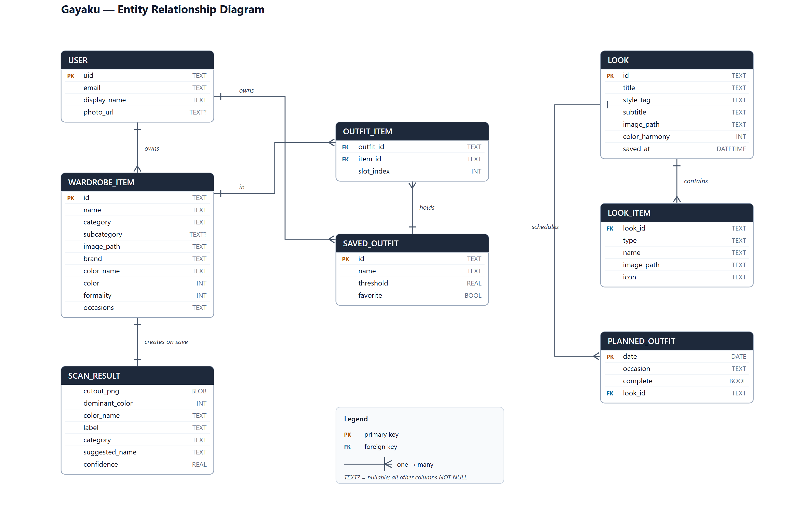
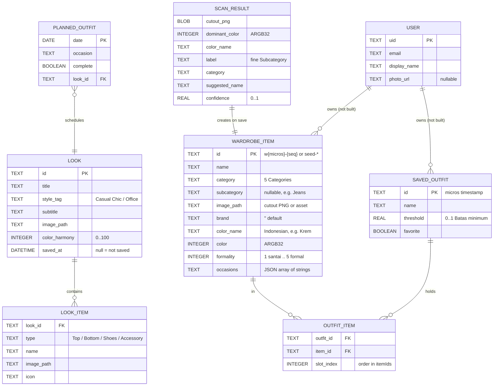

# Gayaku — Entity Relationship Diagram

The logical domain model, as it exists in code today, plus the storage each
entity actually lives in. Terminology follows `CONTEXT.md`; identity decisions
follow `docs/adr/0004-sqlite-ids.md`.

`ERD.png` (3120x2020) is rendered from `erd.svg`; edit the SVG and re-rasterise
to change the picture. The Mermaid source below is the same model for diffing.

## Where each entity lives

| Entity | Storage | Source |
|---|---|---|
| `WARDROBE_ITEM` | **SQLite** — table `wardrobe_items` in `wardrobe.db` (app documents dir, schema v1) | `lib/state/wardrobe_store.dart`, `lib/models/wardrobe.dart` |
| `OUTFIT_ITEM` | none — derived from `SAVED_OUTFIT.itemIds` (ordered list) | `lib/state/outfit_store.dart` |
| `SAVED_OUTFIT` | in-memory `ValueNotifier` (session only) | `lib/state/outfit_store.dart` |
| `LOOK` / `LOOK_ITEM` | static Dart constants (`todaysLook`, `favoriteLooks`) | `lib/models/wardrobe.dart`, `lib/screens/favorites_screen.dart` |
| `PLANNED_OUTFIT` | in-memory static `Map<DateTime, _PlannedOutfit>` | `lib/screens/weekly_planner.dart` |
| `SCAN_RESULT` | transient — exists only between Scan and Correction; becomes a `WARDROBE_ITEM` on save | `lib/logic/scan_pipeline.dart` |
| `USER` | none — model defined but referenced nowhere; login/register do not persist | `lib/models/user_model.dart` |

## Notes and invariants

- **Only `WARDROBE_ITEM` is durable.** Everything else is lost on restart; the
  scanner's promise ("a scanned garment survives a restart") is met by the
  SQLite row plus its Cutout PNG, and nothing more.
- **`OUTFIT_ITEM` is the association, not a table.** `SavedOutfit.itemIds` is an
  ordered `List<String>` of `WARDROBE_ITEM.id`s — ids, never names, so a rename
  cannot split a combination (ADR 0004). `slot_index` is the list position;
  `SavedOutfit.itemsOf` drops ids that no longer resolve.
- **`LOOK_ITEM` references garments by name/path, not by id.** A `Look` is a
  canned suggestion, not a FK to the wardrobe; its `LookItem`s are value objects
  with no identity of their own.
- **`PLANNED_OUTFIT.date` is the identity.** The planner keys entries by a
  `DateTime` in a static map and points them at an existing `LOOK`.
- **Schema has no migrations.** `openDatabase(version: 1, onCreate: …)` creates
  the table and seeds it only when empty; there is no `onUpgrade`. Adding a
  column requires bumping the version and writing that path.

## Not yet modelled

The backend does not exist. `SavedOutfit` carries a `ponytail:` marker to swap
its notifier for Supabase/REST, and `USER` is pre-written for that move. Until
then all ownership edges (`USER` → `WARDROBE_ITEM`, `USER` → `SAVED_OUTFIT`) are
single-user-local and unenforced.
