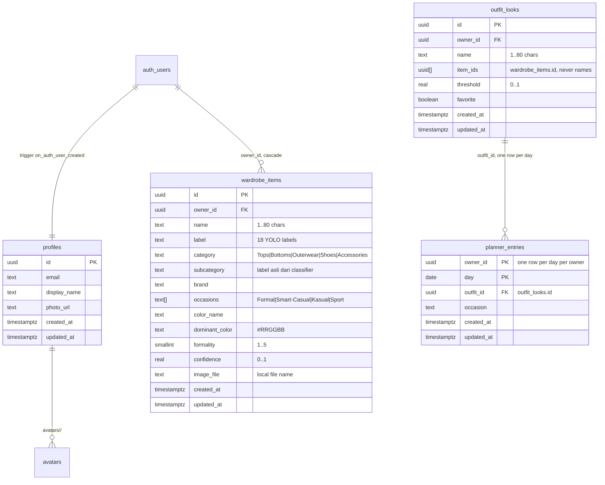

# Supabase backend

Auth, profiles, wardrobe items, the combinations built from them and the weekly
planner for GAYAKU. Every screen reads from here; the device only caches.

```
supabase/
  migrations/20261024120000_profiles.sql        profiles table, RLS, sign-up trigger
  migrations/20261024120100_avatars_bucket.sql  private avatars bucket, per-user rules
  migrations/20261103090000_wardrobe_items.sql  scanned garments + private cutouts bucket
  migrations/20261103091500_wardrobe_local_images.sql  metadata only, cutout PNG stays local
  migrations/20261108120000_wardrobe_align_model.sql   subcategory, brand, occasions
  migrations/20261108160000_outfits_and_planner.sql    outfit_looks + planner_entries
```

## Diagram

`erd.drawio` (buka di draw.io / app.diagrams.net) dan `erd.html` (browser, tanpa dependensi)
menggambarkan skema setelah keempat migrasi. Versi ringkasnya untuk GitHub:



A combination stores `wardrobe_items.id` values, never names, so renaming a
garment keeps every look intact. `planner_entries` is keyed by `(owner_id, day)`,
so planning the same day twice updates the row instead of stacking duplicates.
Empty tables mean empty screens: nothing in the app invents a garment, a look or
a plan.

`auth.users` dan bucket `avatars` dikelola Supabase; `cutouts` sudah pensiun
(lihat `migrations/20261103091500_wardrobe_local_images.sql`).

## What the app talks to

Three services import the Supabase SDK, one per concern; screens never import
it and never see a Supabase type:

- `flutter_app/lib/services/auth_service.dart` — `AuthService`, with
  `DemoAuthService` by default (accepts any credentials, no network) and
  `SupabaseAuthService` when `SUPABASE_URL` + `SUPABASE_PUBLISHABLE_KEY` are
  compiled in. `main()` installs it before the first frame.
- `flutter_app/lib/services/wardrobe_service.dart` — `WardrobeService`
  (`items()`, `save(WardrobeItem)`, `add(ScanResult)`, `remove(id)`), with the
  same Demo/Supabase pair. `SupabaseWardrobeService` writes the cutout PNG to
  the app's documents folder (`cutouts/`, migration `20261103091500`) and
  inserts only the file name into `image_file`.
- `flutter_app/lib/state/wardrobe_sync.dart` — the seam between the two
  backends: `loadWardrobeFromBackend()`, called from `main()`, fills the
  `wardrobeItems` notifier from Supabase, and `saveWardrobeItem(item)` writes
  remote first, then the SQLite cache. Screens keep reading one notifier.

| Screen | Call |
| --- | --- |
| `login_screen.dart` | `authService.signIn(email:, password:)` |
| `register_screen.dart` | `authService.signUp(email:, password:, displayName:)` |
| `profile_screen.dart` | `authService.currentUser`, `authService.signOut()` |
| `wardrobe_screen.dart` | reads `wardrobeItems` (filled by `loadWardrobeFromBackend`) |
| `scan_screen.dart` | `saveWardrobeItem(item)` → `wardrobeService.save` + SQLite cache |
| `outfit_builder_screen.dart` | `saveOutfit(SavedOutfit)` → `outfit_looks` |
| `favorites_screen.dart` | `savedOutfits` filtered on `favorite` |
| `weekly_planner.dart` | `savePlannerEntry` / `deletePlannerEntry` → `planner_entries` |
| `home_screen.dart` | `TodaysLookSection` reads today's `plannerEntries` row |

`AuthException.message` / `WardrobeException.message` are shown in a SnackBar
as-is, so the mapping from Supabase's English errors to Indonesian copy lives in
`_friendly()`.

## What one scan stores

`ScanResult` (`flutter_app/lib/models/scan_result.dart`) is the contract the
scanner emits. It maps one-to-one onto the table:

| ScanResult | `wardrobe_items` column | Notes |
| --- | --- | --- |
| `cutoutPng` | — (Storage object) | `cutouts/<uid>/<microseconds>.png`, private bucket |
| `label` | `label` text | one of the 18 classes in `labels.json`, free text in SQL |
| `category` | `category` text | check: `Tops`, `Bottoms`, `Outerwear`, `Shoes`, `Accessories` |
| `suggestedName` (or the corrected name) | `name` text | 1–80 chars, trimmed |
| `confidence` | `confidence` real | 0..1, nullable |
| `colorName` | `color_name` text | K-Means label, e.g. `Putih` |
| `dominantColor` | `dominant_color` text | `#RRGGBB`, check-constrained |
| `formality` | `formality` smallint | 1..5, seeded from category |
| `label` | `subcategory` text | label asli, `label` menyimpan nama kelas final |
| — | `brand` text | kosong sampai ada input pengguna/tahap OCR |
| `defaultOccasions(category)` | `occasions` text[] | disimpan, bukan diturunkan (`logic/garment_defaults.dart`) |

`owner_id` defaults to `auth.uid()` and every policy tests it, so a client can
neither insert for someone else nor read another user's wardrobe. Item ids are
uuid v4 generated on the device (`logic/ids.dart`), so the id in SQLite equals
`wardrobe_items.id` and a queued offline insert cannot collide.

## First-time setup

1. Create a project at <https://supabase.com/dashboard> (free tier). Note the
   project ref, the API URL and the **publishable** key from *Project Settings →
   API keys* (older projects call it the **anon** key — same slot, same
   behaviour). That key is public by design; RLS is what protects the data.
   Never ship the `secret` / `service_role` key.
2. Apply the migrations. Either paste all six files from `migrations/` into the
   dashboard SQL editor in filename order, or use the CLI:

   ```bash
   npx supabase login
   npx supabase link --project-ref <project-ref>
   npx supabase db push
   ```

3. Run the app with the credentials:

   ```bash
   cd flutter_app
   flutter run --dart-define=SUPABASE_URL=https://<project-ref>.supabase.co \
               --dart-define=SUPABASE_PUBLISHABLE_KEY=<publishable-key>
   ```

   Add the same two `--dart-define` flags to `flutter build apk --release`. A
   build without them silently runs the demo backend.

## Verifying it works

- Sign up in the app, then check *Table Editor → profiles*: one row, with
  `display_name` taken from the sign-up form.
- *Authentication → Users* shows the new user; `email_confirmed_at` is null
  until the confirmation link is clicked, which is why sign-up with email
  confirmation enabled returns to the Sign In screen with a hint.
- In the SQL editor, `select * from profiles;` as the `anon` role returns
  nothing — that is RLS working, not a bug.
- A scan shows up in *Table Editor → wardrobe_items* with `label`,
  `category`, `subcategory`, `occasions`, `dominant_color` and `confidence`
  filled. The PNG stays on the phone: `image_file` is a bare file name and the
  bucket `cutouts` no longer exists.

## Not covered yet

- Google Sign-In. The button says it is not connected; it needs an OAuth client
  and a redirect URL in the dashboard plus `signInWithOAuth` in
  `SupabaseAuthService`.
- Avatar upload. The bucket and policies exist, no screen writes to it.
- Multi-item scan persistence: `scan_screen.dart` saves one garment per scan;
  `docs/multi-item-scan.md` describes the fan-out that is not wired yet.
- Saved looks, favourites, weekly planner. Their tables wait until the matching
  rules settle; `wardrobe_items` is what a look will reference.
- Editing an item in place. `WardrobeService` has no `update`; a changed name
  is saved as a new row (or nothing, if the user backs out).
- Offline writes. Reads fall back to the SQLite cache when the fetch fails;
  a save made while offline fails loudly instead of queueing.
- Session refresh UI. `supabase_flutter` persists the session on disk and
  refreshes tokens on its own.
